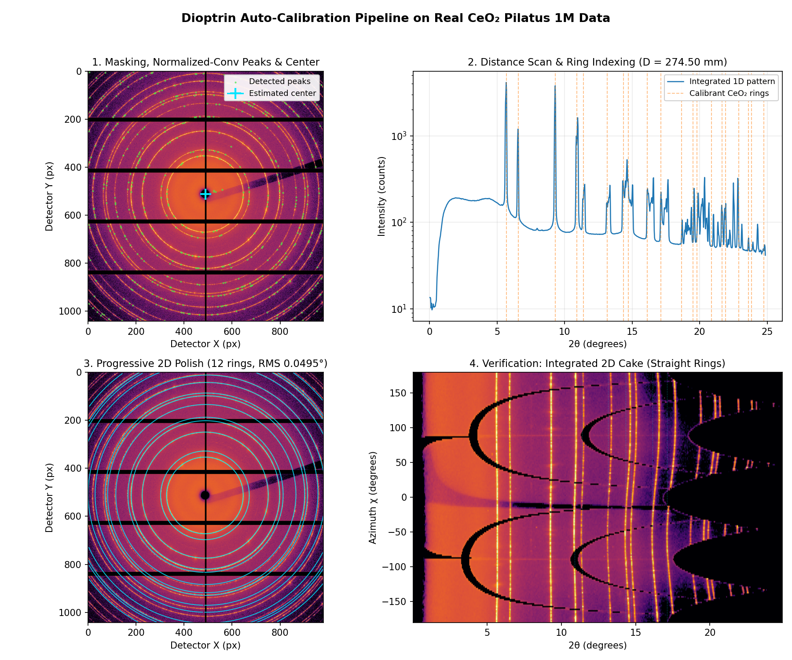
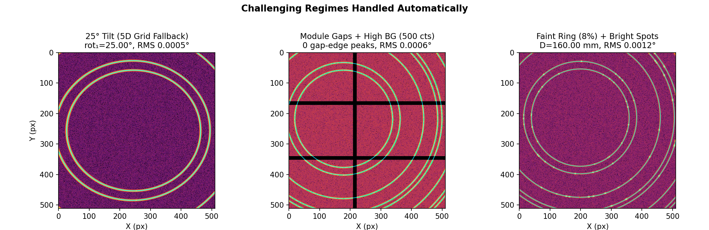

# Automatic 2D Calibration

Dioptrin's `auto_calibrate_image` recovers the full 5-parameter detector
geometry `(distance, poni1, poni2, rot1, rot2)` directly from a raw 2D powder
diffraction frame, a calibrant, the X-ray wavelength, and the pixel dimensions
— with **zero manual clicks** and no required starting guess.



## How the Pipeline Works

`auto_calibrate_image` combines a fast radial-profile path (typically **8–30 ms**
on 512²–1024² detectors) with a 5D tilted/strip grid-search fallback and
strict geometric verification so bad fits are rejected rather than returned.

### 1. Automatic Valid-Pixel Masking

Before any smoothing or peak detection, Dioptrin builds a combined validity mask
from:

- Any explicit user mask (`mask` argument).
- Non-finite pixels (`NaN` / `Inf`) and negative sentinel gap markers (`-1`, `-2`)
  on positive-baseline detectors (while preserving negative noise around zero on
  dark-subtracted float frames).
- **Border-connected exact-zero regions** (e.g. circular active-area corners on
  MarCCD detectors), dilated by 1 pixel.
- **Internal zero-valued module gaps**: rows or columns where $\ge 75\%$ of
  pixels are exact `0.0` on positive-baseline detectors, dilated by 1 pixel.
- **Auto-detected saturation plateaus**: when `intensity_limit` is omitted,
  flat-topped plateaus ($\ge 8$ sampled pixels within $0.1\%$ of a maximum
  $\ge 65\,000$) are masked automatically.

### 2. Mask-Aware Peak Extraction

To avoid artificial intensity ridges along module gaps, beamstops, or circular
detector rims, smoothing and background estimation use **normalized convolution**:

$$\text{smooth} = \frac{G_{\sigma=0.8} * (I \cdot M)}{G_{\sigma=0.8} * M}, \qquad
\text{bg} = \frac{B_{\sigma_{\text{bg}}} * (\text{smooth} \cdot M')}{B_{\sigma_{\text{bg}}} * M'}, \qquad
\text{residual} = \text{smooth} - \text{bg}$$

- The large-scale background blur $B_{\sigma_{\text{bg}}}$ ($\sigma_{\text{bg}} \in [6, 20]\,\text{px}$)
  is computed with a parallel **3-pass $O(1)$ sliding-window box blur** in `f32`
  (independent of $\sigma_{\text{bg}}$) to keep both runtime and memory low on
  large 2048²–4096² detectors.
- Noise $\sigma_r$ is estimated via the subsampled MAD of `residual`, and raw
  pixel noise $\sigma_{\text{raw}}$ from $|I - \text{smooth}|$.
- Extreme isolated single-pixel hot pixels / cosmic rays ($> 12\sigma_{\text{raw}}$
  above local background with even the brightest 8-neighbor $< 12\%$ of the
  center excess) are rejected while preserving real single-pixel Bragg spots.
- Local maxima are refined to sub-pixel precision via 1D parabolic fits. When
  `peak_threshold_sigma` is omitted, extraction starts at $3.5\sigma_r$ and
  automatically relaxes to $2.5\sigma_r$ / $2.0\sigma_r$ on faint images.
- Strong peaks are selected with an $8 \times 8$ spatially balanced quota so
  bright inner rings or single-crystal spots cannot starve fainter outer rings.

### 3. Fast Radial Path (Centered, Off-Center & Moderately Tilted)

1. **Isotropic ring-center estimation**: Peaks are scaled to isotropic pixel
   coordinates and passed to 3-point circle RANSAC followed by multi-scale
   radial histogram sharpness maximization (`Σ c²`), handling off-detector beam
   centers as well as centered detectors.
2. **1D radial profile & F1 distance scan**: Both the 2D image and the peak list
   are binned into 1D radial SNR profiles. Candidate distances $D$ are scored
   across `[distance_min, distance_max]` (or around `starting_distance`) using a
   precision/recall F1 score against strong calibrant rings (prioritizing
   reflections with $\ge 3\%$ relative intensity when `calibrant.intensities`
   are present).
3. **Progressive 2D ring refinement**: For the top distance candidates, rings
   are projected onto the 2D residual image and refined with Huber-loss
   Levenberg–Marquardt in **three progressive passes**:
   - **Pass 1 (coarse lock)**: innermost **6 rings**, wider radial search window.
   - **Pass 2 (mid expansion)**: up to **12 rings**, tighter window.
   - **Pass 3 (full polish)**: up to `max_ring_index.min(28)` rings, fine window
     adapted to the estimated 1D ring FWHM (clamped to $< 0.45\times$ local
     inter-ring spacing so dense rings stay separated).

   Locking the coarse geometry on the innermost rings first prevents outer
   high-$2\theta$ rings from jumping onto neighboring rings when initial tilt
   or distance is approximate. If the leading candidate achieves a tight,
   verified fit (and clearly leads candidate #2), remaining candidates are
   skipped early.

### 4. 5D Tilted & Strip-Detector Fallback

If the detector is a narrow strip (aspect ratio $> 2.5$) or the radial path
cannot produce a tight verified fit (e.g. $15^\circ$–$35^\circ$ tilt), Dioptrin
runs a parallel 5D coarse grid search over `(distance, poni1, poni2, rot1, rot2)`:

- **Two complementary parameterizations** run in parallel:
  1. **PONI-centered** around the peak centroid (side-mounted / high-$2\theta$
     tilted detectors where the direct beam is far off-detector).
  2. **Beam-centered** around the peak centroid (tilted detectors where the
     direct beam stays near the detector and the PONI shifts by
     $(-D \tan\text{rot}_2 / \cos\text{rot}_1,\, +D \tan\text{rot}_1)$).
- **Fast inner loop**: `(rot1, rot2)` rotation matrices are hoisted so all
  working peaks are pre-rotated once per rotation pair into L1-resident `f32`
  arrays. Each peak's $\sin(2\theta / 2)$ is computed without `atan2` via the
  cancellation-free identity
  $\sin(2\theta/2) = \sqrt{(x^2 + y^2) / (2 n (n + z))}$ and looked up in an
  $O(1)$ spacing-aware `RingLut` using a 3rd-order rational Gaussian
  approximation.
- Top deduplicated basins are L-M refined in parallel with Rayon, checked
  against their mirror-tilt twin `(-rot1, -rot2)` around the direct-beam
  intersection, and polished on the 2D residual image.

### 5. Verification & Automatic Retry

Every candidate geometry is verified on the full detected peak set:

- Spacing-aware **inlier fraction** and unbiased **inlier RMS**.
- Intensity-weighted **ring recall**, including checking whether inner
  predicted rings project onto valid detector pixels outside a central beamstop
  (rejecting $D / \sqrt{2}$ and tiny-distance aliases).
- Physical distance bounds and grazing-tilt guard ($|\text{rot}| \le 60^\circ$).

If primary calibration fails verification, Dioptrin automatically retries once
with a relaxed peak threshold ($2.0\sigma$), a tighter inner-ring cap (12), and
auto-saturation unclipped before returning `NoConfidentIdentity`.

## Challenging Regimes



`auto_calibrate_image` is tested across 31 synthetic regimes (plus real Pilatus,
MarCCD, PerkinElmer, and side-strip detectors), including steep tilts up to
$35^\circ$, off-detector beams, non-square pixels, broad/Lorentzian peaks,
zero-valued module gaps on high backgrounds, dense 600-ring calibrants
(`Cr2O3`), isolated hot pixels, and faint continuous rings with bright
single-crystal spots on top.

## Usage

### Python

```python
import numpy as np
import dioptrin

cal = dioptrin.Calibrant.builtin("CeO2")

# Blind calibration (no starting distance required)
result, diag = dioptrin.auto_calibrate_image(
    image,                 # 2D float64 NumPy array (dim1, dim2)
    cal,
    wavelength=0.31e-10,   # metres
    pixel1=172e-6,         # metres (row pixel size)
    pixel2=172e-6,         # metres (column pixel size; defaults to pixel1)
    starting_distance=None, # optional distance hint in metres
    mask=None,             # optional bool mask (True = masked)
)

print(f"D = {result.poni.distance * 1e3:.2f} mm, RMS = {np.degrees(result.rms_rad):.4f} deg")
print(f"Identified rings: {diag.n_identified_ellipses}")
```

### Rust (with Live Progress & Cancellation)

```rust
use dioptrin::calibration::{
    AutoCalibrateImageOptions, Calibrant, auto_calibrate_image_with_progress,
};

let cal = Calibrant::builtin("CeO2")?;
let opts = AutoCalibrateImageOptions::default();

let (result, diag) = auto_calibrate_image_with_progress(
    &frame.data,
    frame.dim1,
    frame.dim2,
    None, // optional mask: Option<&[bool]>
    &cal,
    0.31e-10,
    172e-6,
    172e-6,
    &opts,
    |ev| {
        println!("[{:>3.0}%] {:?}: {}", ev.progress * 100.0, ev.stage, ev.message);
        true // return false to cancel with AutoCalibrateError::Cancelled
    },
)?;
```

## Key Options

| Option | Default | Effect |
|---|---|---|
| `starting_distance` | `None` | Optional approximate distance in metres. Searches `[d0 / factor, d0 * factor]` instead of the full `[distance_min, distance_max]` range. |
| `distance_min` / `distance_max` | `0.03` / `1.5` m | Blind search bounds when `starting_distance` is `None`. |
| `enable_tilt_fallback` | `true` | Enables the 5D grid-search fallback for steep tilts ($> 12^\circ$) and narrow strip detectors. |
| `max_ring_index` | `60` | Maximum calibrant ring index considered during polish and verification. |
| `intensity_limit` | `None` (auto) | Optional upper intensity cutoff. When `None`, flat-topped saturation plateaus $\ge 65\,000$ are detected automatically. |
| `peak_threshold_sigma` | `None` (auto) | Optional peak SNR threshold. When `None`, starts at $3.5\sigma$ and relaxes automatically on faint frames. |
| `search_half_width_px` | `None` (auto) | Optional radial search half-width for 2D ring extraction. When `None`, adapts to the measured 1D ring FWHM. |
