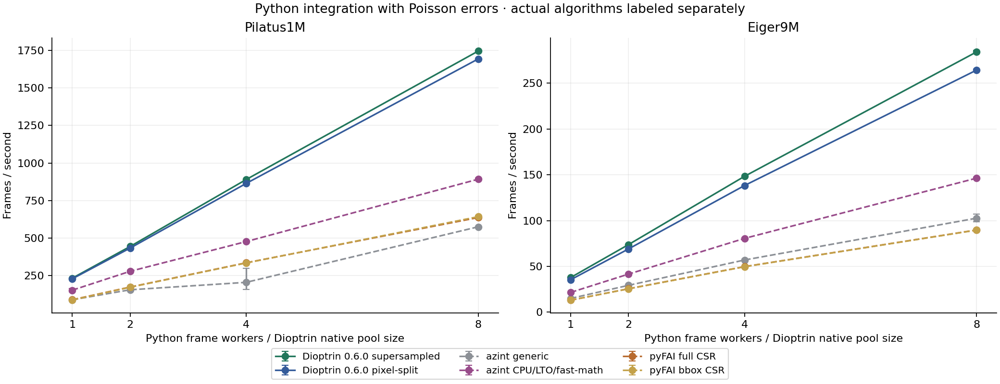
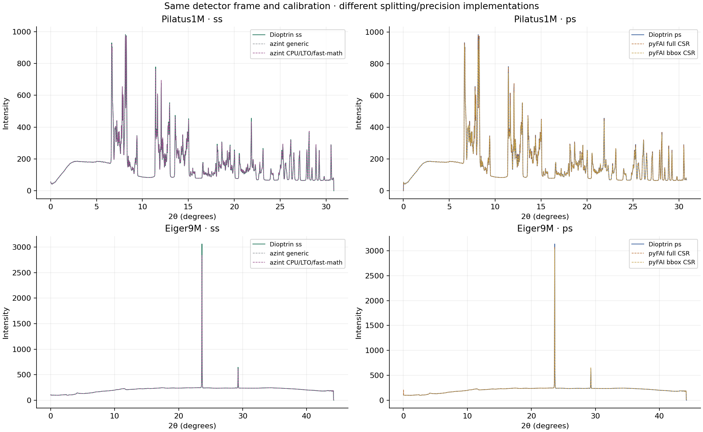

# Dioptrin 0.6.0 versus azint and pyFAI

| Detector | Library / method | Poisson fps | Workers ready (s) | First result (s) | Peak RSS (GiB) | Live heap (MiB) |
| --- | --- | --- | --- | --- | --- | --- |
| Pilatus1M | Dioptrin 0.6.0 supersampled | 1746.2 | 0.370 | 0.370 | 0.549 | 105.5 |
| Pilatus1M | Dioptrin 0.6.0 pixel-split | 1693.8 | 0.099 | 0.099 | 0.796 | 108.2 |
| Pilatus1M | azint generic | 574.0 | 0.768 | 0.768 | 0.592 | 75.2 |
| Pilatus1M | azint CPU/LTO/fast-math | 891.6 | 0.757 | 0.757 | 0.592 | 75.2 |
| Pilatus1M | pyFAI full CSR | 635.8 | 1.319 | 0.570 | 1.440 | 1002.1 |
| Pilatus1M | pyFAI bbox CSR | 641.4 | 0.902 | 0.534 | 0.987 | 525.0 |
| Eiger9M | Dioptrin 0.6.0 supersampled | 284.2 | 0.679 | 0.679 | 2.528 | 697.3 |
| Eiger9M | Dioptrin 0.6.0 pixel-split | 264.3 | 0.561 | 0.561 | 3.598 | 722.4 |
| Eiger9M | azint generic | 102.6 | 1.860 | 1.860 | 3.255 | 431.3 |
| Eiger9M | azint CPU/LTO/fast-math | 146.3 | 1.924 | 1.924 | 3.253 | 431.3 |
| Eiger9M | pyFAI full CSR | 89.7 | 7.305 | 1.835 | 10.063 | 8138.6 |
| Eiger9M | pyFAI bbox CSR | 89.6 | 3.561 | 1.438 | 5.158 | 3265.6 |

Same preloaded float64 images, masks, geometry, 2000 2theta bins, polarization 0.965, solid-angle correction, 56 frame references, Poisson on/off, 1/2/4/8 Python frame threads, two fresh-process trials, three warmed timing blocks targeting 0.5 s, 10 ms external RSS sampling and <=3.6-other-busy-core median screen in both error modes. Imports and input warm-up excluded. pyFAI uses a shallow geometry copy and a separate initialized CSR engine per worker, initialized sequentially from shared geometry arrays; first-result and all-workers-ready setup times are both recorded. pyFAI uses safe=True and its native float32 CSR data path. The installed macOS wheel has no libomp dependency; OMP_NUM_THREADS=1 prevents nested parallelism. azint shares the sparse matrix through shallow copies, uses n=15/5, and integrates on Python frame threads; OMP_NUM_THREADS equals c only for its parallel matrix construction. azint generic and CPU/LTO/fast-math builds are separate variants. No claims of identical algorithms or output patterns between libraries.

Supersampled Dioptrin and azint use the same subpixel count, but their geometry precision and correction/normalization conventions differ. pyFAI full CSR is the closest geometric pixel-split comparison; bbox CSR is its default approximation and is listed separately. pyFAI uses float32 internal data while Dioptrin retains float64. For raw counts S, correction normalization C and bin fraction w, azint averages corrected pixels as sum(w*S/C)/sum(w); Dioptrin uses sum(w*S)/sum(w*C). This estimator difference is retained. These are same-task comparisons, not assertions of algorithmic or numerical identity. See the numerical record for axis and intensity/sigma differences. Timings exclude file decoding and acquisition.

## Adjacent eight-worker controls

| Detector | Competitor | Paired Dioptrin speed factor | Qualified pairs |
| --- | --- | --- | --- |
| Pilatus1M | azint generic | 2.99× | 4/4 |
| Pilatus1M | azint CPU/LTO/fast-math | 1.92× | 4/4 |
| Pilatus1M | pyFAI full CSR | 2.59× | 3/4 |
| Pilatus1M | pyFAI bbox CSR | 2.65× | 4/4 |
| Eiger9M | azint generic | 2.59× | 4/4 |
| Eiger9M | azint CPU/LTO/fast-math | 1.90× | 4/4 |
| Eiger9M | pyFAI full CSR | 2.98× | 4/4 |
| Eiger9M | pyFAI bbox CSR | 2.99× | 4/4 |

Four adjacent AB/BA pairs at eight workers, Poisson errors, 56 warmed frame references, targeting 0.5 seconds per block. Separate persistent processes, only one integrating at a time. Both sides must satisfy <=3.6 other busy logical cores. Resident calibration data in the idle process can change cache conditions; use this as a control alongside fresh-process results.

## Numerical differences for the first image

| Detector | Competitor | Maximum axis offset (degrees) | Intensity relative L2 | Poisson sigma relative L2 |
| --- | --- | --- | --- | --- |
| Pilatus1M | azint generic | 3.553e-15 | 1.1682% | 0.47876% |
| Pilatus1M | azint CPU/LTO/fast-math | 3.553e-15 | 1.1682% | 0.47868% |
| Pilatus1M | pyFAI full CSR | 3.677e-06 | 0.24274% | 1.7888% |
| Pilatus1M | pyFAI bbox CSR | 3.677e-06 | 5.3199% | 25.265% |
| Eiger9M | azint generic | 7.105e-15 | 2.9425% | 0.2816% |
| Eiger9M | azint CPU/LTO/fast-math | 7.105e-15 | 2.9425% | 0.28169% |
| Eiger9M | pyFAI full CSR | 5.274e-06 | 1.3315% | 316.17% |
| Eiger9M | pyFAI bbox CSR | 5.274e-06 | 1.2547% | 7.5537% |

These are corresponding-bin differences; bin-center offsets are reported separately. Interpolated differences and all self-reference checks are retained in the numerical JSON.

[All measurements CSV](dioptrin-0.6.0-comparison-speed-memory.csv) · [Numerical checks](dioptrin-0.6.0-comparison-numerical.json) · [Measurement record](dioptrin-0.6.0-measurement-record.json)

[Release comparison](2026-10-24-0.6.0.md) · [azint and pyFAI comparison](2026-10-24-0.6.0-comparison.md)
