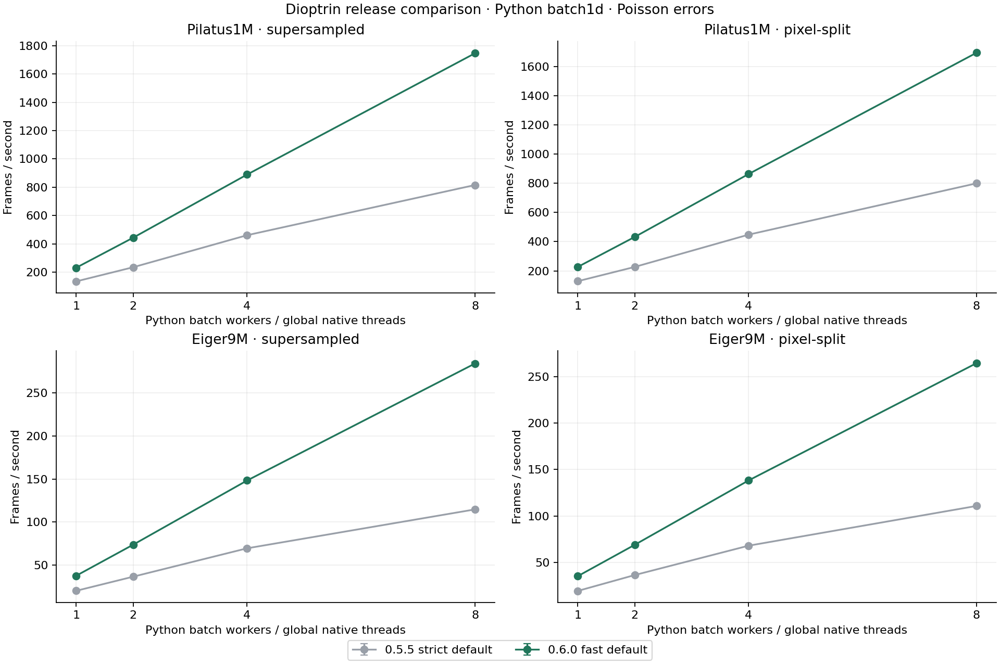
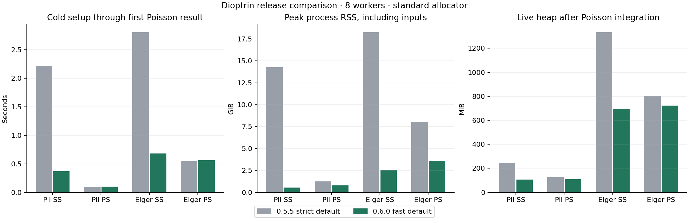

# Dioptrin 0.6.0 integration performance

Measured 24 October 2026. Published 0.5.5 versus the licensed 0.6.0 release build, using the default arithmetic of each version.

| Detector / method | 0.5.5 fps | 0.6.0 fps | Speed factor | Setup old → new (s) | Peak RSS old → new (GiB) |
| --- | --- | --- | --- | --- | --- |
| Pilatus1M / supersampled | 815.4 | 1746.2 | 2.14× | 2.223 → 0.370 | 14.263 → 0.549 |
| Pilatus1M / pixel-split | 799.6 | 1693.8 | 2.12× | 0.093 → 0.099 | 1.250 → 0.796 |
| Eiger9M / supersampled | 114.8 | 284.2 | 2.48× | 2.805 → 0.679 | 18.249 → 2.528 |
| Eiger9M / pixel-split | 110.8 | 264.3 | 2.38× | 0.548 → 0.561 | 8.050 → 3.598 |


Python batch1d on 56 references to preloaded float64 images, 2000 uniform 2theta bins, masks, polarization 0.965 and solid-angle correction. Supersampling n=15 for Pilatus1M and n=5 for Eiger9M; pixel_split has no n. One global Rayon pool configured to 1/2/4/8; three warmed blocks per error mode targeting 0.5 s; two fresh process trials. Imports, pool configuration and input preloading excluded from setup; cold geometry, LUT creation, denominator preparation and first Poisson result included. RSS sampled externally every 10 ms. All final points satisfy median other CPU load <=3.6 logical cores in both error modes; failed attempts retained. Paired AB/BA comparisons at 1 and 8 workers run only one integrator process at a time. Official licensed 0.5.5 and CI-built licensed 0.6.0 wheels, with fast_math argument omitted. No allocator override or machine-specific compiler flags. SFSCXRD temporarily paused under authorization and resumed; Peritheos validation allowed to finish. Additional Dioptas/PhaseSmith calculations temporarily paused and resumed under separate explicit authorization.

Speed factors are specific to this warmed in-memory workload and machine. Disk/HDF5 decoding and acquisition are excluded. 56 references reuse preloaded frames; this measures integration throughput rather than independent disk reads. Peak RSS includes mapped input pages, Python, temporary construction buffers and allocator retention. Live heap and USS are retained separately in the CSV/JSON; RSS is not the calibration-table size.

## Numerical behavior

Default-mode maximum relative L2 intensity difference: 7.06e-15; Poisson sigma: 1.32e-15. Fast mode changes rounding because it reassociates float64 sums and uses fused multiply-add. `fast_math=False` selects the previous strict accumulation. Explicit strict-mode results are byte-identical to 0.5.5 on both detectors and algorithms. All 96 release-wheel real-image A/B return checks pass exactly, covering sequential and eight-worker batch integration in both arithmetic modes. The numerical JSON retains these checks.

## What changed

- Synchronous float64 NumPy batches borrow inputs instead of copying every frame.
- Internal CSR execution tables use checked 32-bit indices where possible.
- Poisson variance is evaluated in the integration loop.
- Per-bin normalization is cached and invalidated when calibration, mask or corrections change.
- Supersampled construction counts per-pixel bin contributions instead of collecting every sample.
- Fast CSR accumulation is enabled by default; calibration geometry and float64 weights remain unchanged.

## Evidence

Candidate wheel: `dioptrin-0.6.0-cp313-cp313-macosx_11_0_arm64.whl`; SHA-256 `e13b2e16e040b8f0fca28197ea1b3ffed933435e3c3da621ee65226e640edcfa`.
Candidate wheel CI run: https://github.com/CPrescher/Dioptrin/actions/runs/40110812176

Machine: "Apple M4 Pro, 10 performance + 4 efficiency cores, 48 GiB RAM"

Companion CSV records every dataset, method, worker count and error mode. JSON retains process trials, CPU-load qualification, native binary hashes, input hashes, timing blocks, memory samples and numerical comparisons.

Configure the global native pool once, before the first integration, when reproducing worker counts:

```python
dioptrin.set_rayon_threads(8)
results = integrator.batch1d(images, 2000, errors=True, num_workers=8, num_threads=1)
```

The NumPy array path uses the global Rayon pool; changing num_workers alone does not resize that pool. Each measured point runs in a fresh Python process.





[All measurements CSV](dioptrin-0.6.0-release-speed-memory.csv) · [Numerical checks](dioptrin-0.6.0-release-numerical.json) · [Measurement record](dioptrin-0.6.0-measurement-record.json)

[Release comparison](2026-10-24-0.6.0.md) · [azint and pyFAI comparison](2026-10-24-0.6.0-comparison.md)
