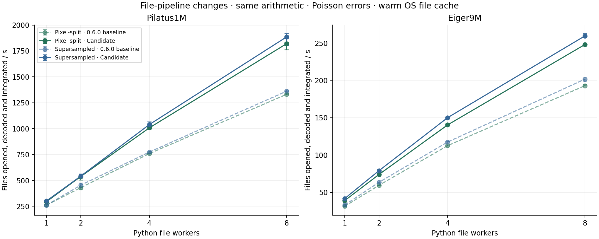
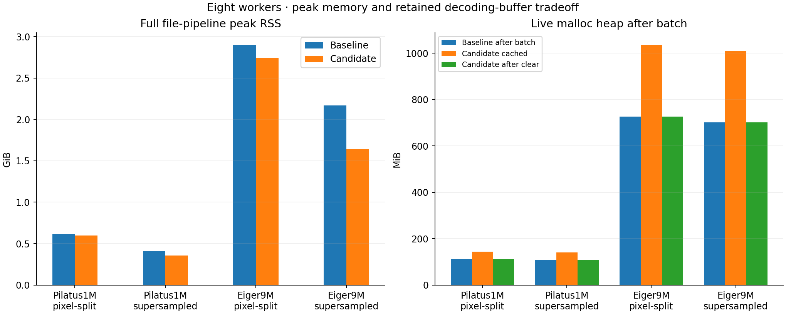

# Dioptrin 0.6.1 file-pipeline optimization

Measured 24 October 2026 on the release candidate whose implementation is included in 0.6.1. Three file-path changes, with the arithmetic policy unchanged. The archived measurement record retains the candidate’s original build identity.

## Eight Python workers

| Detector / method | File fps before → after | Speedup | Calibration s before → after | First 32-file batch s before → after | Peak RSS GiB before → after |
| --- | --- | --- | --- | --- | --- |
| Pilatus1M / pixel-split | 1331.4 → 1820.4 | 1.37× | 0.107 → 0.108 | 0.024 → 0.019 | 0.616 → 0.599 |
| Pilatus1M / supersampled | 1361.9 → 1885.9 | 1.38× | 0.373 → 0.371 | 0.024 → 0.018 | 0.409 → 0.356 |
| Eiger9M / pixel-split | 192.9 → 248.0 | 1.29× | 0.603 → 0.613 | 0.171 → 0.136 | 2.901 → 2.742 |
| Eiger9M / supersampled | 201.7 → 259.6 | 1.29× | 0.702 → 0.701 | 0.170 → 0.127 | 2.168 → 1.640 |

## Retained memory and array control

| Detector / method | Live heap MiB baseline | Live heap MiB candidate cached | Live heap MiB candidate after clear | Warm peak RSS GiB before → after | Array-control fps before → after |
| --- | --- | --- | --- | --- | --- |
| Pilatus1M / pixel-split | 111.9 | 143.2 | 111.9 | 0.616 → 0.599 | 1694.9 → 1705.0 |
| Pilatus1M / supersampled | 109.1 | 140.4 | 109.1 | 0.409 → 0.356 | 1744.6 → 1747.1 |
| Eiger9M / pixel-split | 726.0 | 1035.6 | 726.0 | 2.901 → 2.742 | 271.9 → 272.2 |
| Eiger9M / supersampled | 700.9 | 1010.5 | 700.9 | 2.168 → 1.640 | 289.1 → 289.5 |

Persistent workers deliberately retain one typed decoding buffer each. For eight Eiger workers this adds about 310 MiB of live heap after the batch, while avoiding repeated float64 frame allocation/conversion. clear_file_workers() returns live heap to approximately the baseline level. RSS also includes allocator-retained freed pages and setup transients, so it need not fall immediately when buffers are freed. Pixel-split setup may dominate total peak RSS even when the file path uses less scratch space. Calibration and first-batch timings are reported separately because persistent worker creation occurs in the first batch; it is excluded only from subsequent warm batches.

## Implementation

The decoder writes into a reusable typed buffer owned by each worker. Grayscale strips and tiles, including padded edge tiles, use TIFF read_chunk_to_buffer; row reversal happens in that compact typed buffer. Standard 1D/2D CSR file tasks load the native sample type and convert each used value to float64 immediately before the existing weight and accumulation operations. Float64 weights, strict/fast lane order, normalization and Poisson formulas are unchanged. The Python Integrator retains one worker pool for its current worker/thread configuration, including each worker’s decoding buffer; changing configuration replaces the pool. List, streaming-list and generator file APIs use the pool. clear_file_workers() releases cached workers and buffers; already admitted streaming work finishes safely. The public float64 Frame/NumPy interfaces remain compatible. Histogram, azimuthal spread and custom IntegrationTask implementations use a float64 compatibility adapter. The 2D array-stream producer also now feeds its bounded queue concurrently, avoiding a pre-existing deadlock when the input list exceeds the queue capacity. This measured implementation is included in 0.6.1; the archived 0.6.0 baseline is retained for comparison.

## Numerical validation

All 6,144 primary file/array frame results (axis, intensity and Poisson sigma) are byte-identical to the archived 0.6.0 references. The standalone Python regression script checked 13744 results against the float64 array path, covering strict and fast modes, ten signed/unsigned/float sample types, both byte orders, uncompressed/Deflate/LZW TIFFs, strips and padded tiles, masked/nonfinite/negative/extreme values, alternating and overwritten images, read failures, 1D/2D batches, generators and iterator lifetime after parent deletion. Rust checks passed 162 unit tests and 16 documentation tests; formatting and Clippy with warnings denied passed. NumPy array integration remains float64 and has its own timing control; file-only gains should not be described as an equivalent array-kernel speedup.

## Protocol

Apple M4 Pro (10 performance + 4 efficiency cores), 48 GiB RAM; CPython 3.13.5; licensed local release builds of the unchanged 0.6.0 engine and the unreleased candidate, using the same compiler, locked dependencies and generic CPU target (opt-level=3, LTO=true, codegen-units=1). fast_math=True remains the default in both builds. Python batch1d(path_list), 1/2/4/8 workers, num_threads=1; the same single shared geometry/CSR per integrator. Each batch reopens and decodes 32 uncompressed int32 TIFF files: 32 copies of one Pilatus1M frame (1043×981), or 16 distinct real Eiger9M frames (3262×3108), each read twice. 2,000 uniform 2theta bins, solid-angle correction, polarization 0.965 and Poisson errors. Supersampling n=15 (Pilatus1M) / n=5 (Eiger9M); pixel-split has no subpixel count. The same mirrored PONI/mask coordinates and archived 0.6.0 one-worker array oracles as the preceding file study are used. Three fresh-process trials per point; baseline/candidate order alternates. Three warm timing blocks target 0.5 seconds each, including returned result allocation/release. Both file and array timing phases require <=3.6 other busy cores; failed attempts are retained separately. Only previously authorized SFSCXRD and Dioptas/PhaseSmith calculations are paused; Peritheos validation is allowed to finish. All paused calculations are resumed after the sweep. Normal macOS filesystem caches are warm; caches are not flushed. This is fresh file opening/decoding, not a cold-SSD or network-storage measurement. The first file calibrates the integrator. First-batch time additionally includes worker creation and the first 32 file tasks; warm throughput uses retained workers/buffers in the candidate. File RSS is sampled externally every 10 ms and excludes the later float64 array stack. The candidate releases its file workers before the independent float64 NumPy-array control. File workers reuse compact int32 storage; the array control retains separate float64 image buffers. A smaller working set and typed input can make the file workflow exceed the array-control rate without caching decoded images. Their difference is therefore not an isolated measurement of storage cost. Live malloc heap, USS and footprint snapshots are retained before and after worker release. The inherited MallocNanoZone=0 is the same in both builds; MallocLargeCache is unset. No acquisition, GUI or output-file writing is timed.

[All worker counts and metrics](dioptrin-file-pipeline-optimization-speed-memory.csv) · [Numerical record](dioptrin-file-pipeline-optimization-numerical.json)
