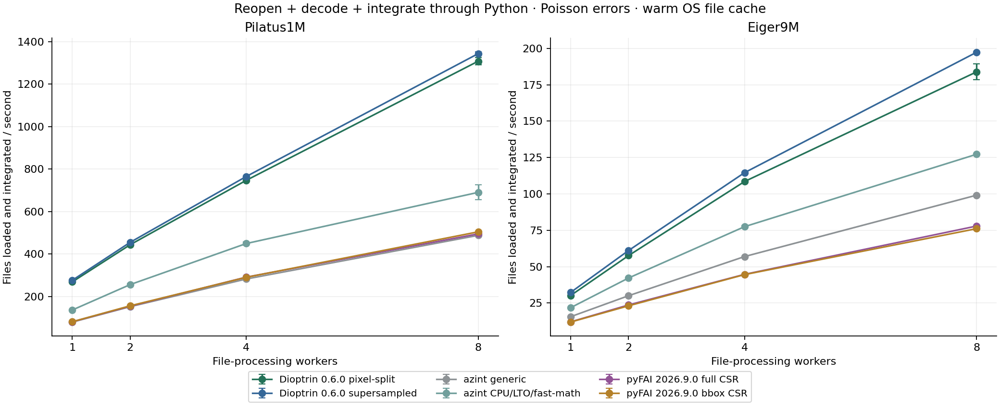
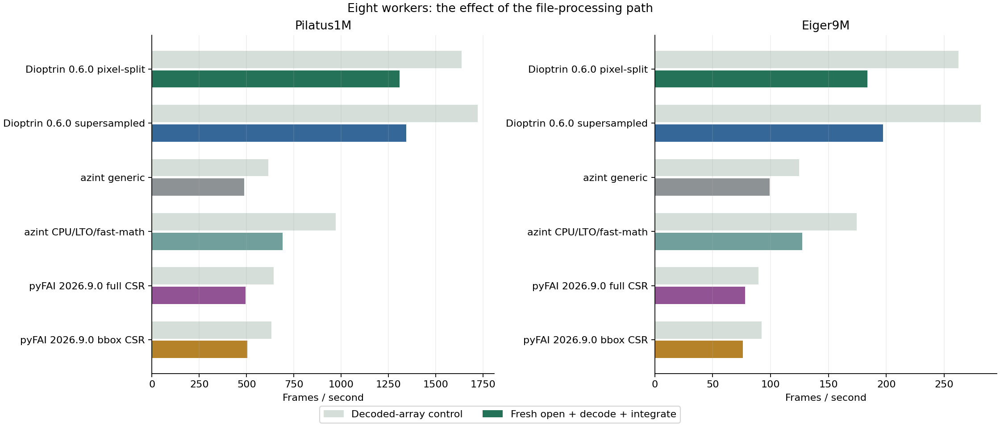
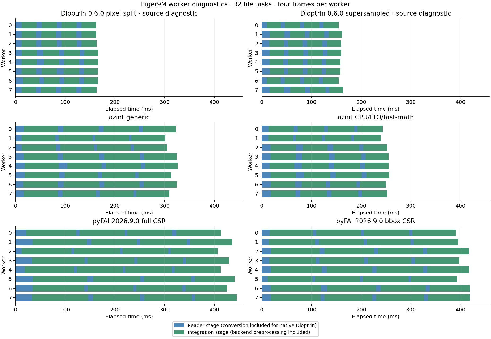

# File-backed Python integration — Dioptrin, azint and pyFAI

Every image is reopened and decoded inside its assigned worker. Both file and array modes matched their own library’s one-worker reference byte-for-byte across all 6,144 frame results. The file-processing path reduces eight-worker throughput; the amount depends on the backend. Memory figures below describe the file workflow and exclude the later decoded-array control.

## Eight workers, Poisson errors

| Detector | Library / method | File fps | Array-control fps | File/array rate | Logical TIFF MiB/s |
| --- | --- | --- | --- | --- | --- |
| Pilatus1M | Dioptrin 0.6.0 pixel-split | 1307.5 | 1636.5 | 79.9% | 5108 |
| Pilatus1M | Dioptrin 0.6.0 supersampled | 1343.1 | 1722.2 | 78.0% | 5248 |
| Pilatus1M | azint generic | 488.0 | 614.1 | 79.5% | 1907 |
| Pilatus1M | azint CPU/LTO/fast-math | 690.3 | 972.1 | 71.0% | 2697 |
| Pilatus1M | pyFAI 2026.9.0 full CSR | 495.0 | 644.2 | 76.8% | 1934 |
| Pilatus1M | pyFAI 2026.9.0 bbox CSR | 504.6 | 630.2 | 80.1% | 1971 |
| Eiger9M | Dioptrin 0.6.0 pixel-split | 183.8 | 262.5 | 70.0% | 7110 |
| Eiger9M | Dioptrin 0.6.0 supersampled | 197.3 | 281.5 | 70.1% | 7631 |
| Eiger9M | azint generic | 99.1 | 124.7 | 79.5% | 3833 |
| Eiger9M | azint CPU/LTO/fast-math | 127.2 | 174.3 | 73.0% | 4921 |
| Eiger9M | pyFAI 2026.9.0 full CSR | 77.9 | 89.7 | 86.9% | 3013 |
| Eiger9M | pyFAI 2026.9.0 bbox CSR | 76.1 | 92.3 | 82.4% | 2944 |

## Setup and file-pipeline memory

| Detector | Library / method | Calibration/engines ready (s) | First file result (s) | File peak RSS (GiB) | Live heap after batch (MiB) |
| --- | --- | --- | --- | --- | --- |
| Pilatus1M | Dioptrin 0.6.0 pixel-split | 0.107 | 0.103 | 0.613 | 112.6 |
| Pilatus1M | Dioptrin 0.6.0 supersampled | 0.369 | 0.365 | 0.410 | 109.8 |
| Pilatus1M | azint generic | 0.767 | 0.767 | 0.427 | 90.5 |
| Pilatus1M | azint CPU/LTO/fast-math | 0.764 | 0.764 | 0.431 | 90.5 |
| Pilatus1M | pyFAI 2026.9.0 full CSR | 1.288 | 0.572 | 1.249 | 1002.7 |
| Pilatus1M | pyFAI 2026.9.0 bbox CSR | 0.908 | 0.537 | 0.796 | 525.6 |
| Eiger9M | Dioptrin 0.6.0 pixel-split | 0.567 | 0.563 | 2.879 | 726.7 |
| Eiger9M | Dioptrin 0.6.0 supersampled | 0.680 | 0.675 | 2.169 | 701.6 |
| Eiger9M | azint generic | 1.836 | 1.836 | 2.664 | 431.8 |
| Eiger9M | azint CPU/LTO/fast-math | 1.797 | 1.797 | 2.646 | 431.8 |
| Eiger9M | pyFAI 2026.9.0 full CSR | 7.231 | 1.732 | 8.640 | 8139.2 |
| Eiger9M | pyFAI 2026.9.0 bbox CSR | 3.591 | 1.420 | 4.550 | 3266.2 |

## Worker-stage diagnostics for Eiger9M

| Library / method | Reader stage (ms/frame) | Integration stage (ms/frame) | Reader share of worker wall | Last-worker tail (ms) |
| --- | --- | --- | --- | --- |
| Dioptrin 0.6.0 pixel-split | 10.87 | 30.19 | 26.5% | 5.1 |
| Dioptrin 0.6.0 supersampled | 10.22 | 29.23 | 25.9% | 10.1 |
| azint generic | 10.82 | 68.27 | 13.7% | 21.1 |
| azint CPU/LTO/fast-math | 11.30 | 51.04 | 18.1% | 19.5 |
| pyFAI 2026.9.0 full CSR | 13.52 | 94.46 | 12.5% | 33.8 |
| pyFAI 2026.9.0 bbox CSR | 9.63 | 91.69 | 9.5% | 29.1 |

Worker-stage traces are separate diagnostic runs at eight workers. Dioptrin uses instrumented Rust 0.6.0 source equivalent to the native file-batch implementation, with outputs checked against the published wheel. Its read stage includes TIFF decoding, float64 conversion and row reversal. azint/pyFAI traces use the published Python interfaces; their read stage ends at the decoded NumPy view, so backend dtype/layout preprocessing remains in the integration stage. Stage percentages describe each implementation; they are not a subtraction of the two throughput measurements. Timed primary throughput always comes from the published Python interfaces.

## Input-buffer reuse control

Dioptrin 0.6.0 pixel-split at one worker: 226.7 fps for 32 separate array buffers versus 318.8 fps when the same buffer is reused, with identical pixel values and results. Dioptrin 0.6.0 supersampled at one worker: 233.5 fps for 32 separate array buffers versus 328.9 fps when the same buffer is reused, with identical pixel values and results. This isolates a working-set effect. A native file worker reuses its image buffer; the array-stack control retains separate decoded frames. A file path can therefore sometimes outperform that array control without making file loading free.

## Protocol

Apple M4 Pro, CPython 3.13.5, 1/2/4/8 workers, 2,000 2theta bins, solid-angle correction, polarization 0.965, Poisson errors. Supersampling n=15 for Pilatus1M and n=5 for Eiger9M; pixel-split has no subpixel count. Each batch has 32 file tasks: 32 separate TIFF copies of one Pilatus image, or 16 distinct real Eiger images read twice. All TIFFs are uncompressed signed int32. Every file-mode task freshly opens and decodes its file. pyFAI and azint receive the decoded int32 NumPy views and perform their own backend preprocessing; Dioptrin converts file pixels to float64 internally and its array control requires float64 arrays. These natural input dtypes differ from the earlier uniformly float64 integration-only comparison, so rates between those studies are not a controlled measure of file cost. The matched controls within this study provide that workflow comparison. Dioptrin uses the published 0.6.0 Python batch1d(path_list) API with num_workers=c and num_threads=1; it shares geometry/CSR tables and creates worker pools per batch. azint and pyFAI use persistent Python frame threads, one independent integrator state per worker; pyFAI keeps a separate initialized CSR engine per worker. All distribute equal contiguous file chunks, 32/c frames per worker. azint generic and CPU/LTO/fast-math are separate builds. OMP_NUM_THREADS=1 for pyFAI and c for azint matrix construction; no nested numerical-thread oversubscription. Calibration setup includes construction, the first file read/result and preparation of all engine states; lazy imports inside pyFAI.load remain included. File-worker creation is included each time in Dioptrin batch throughput. Two fresh-process trials per point, alternating variant order; three warm timing blocks targeting 0.5 s, including result allocation and release. Both file and array controls must satisfy <=3.6 other busy cores. File mode runs first, followed by the matched array control; only the later control retains the decoded image stack. File-pipeline RSS is sampled externally every 10 ms and excludes that later input stack. Live heap, USS and physical footprint are also retained. All trials inherit the host MallocNanoZone=0; MallocLargeCache is unset. File bytes are served through the normal macOS filesystem cache; caches are not flushed. Reported payload rates are logical file bytes, not measured physical-SSD bandwidth. The TIFF reader orientation is matched across libraries by a row flip, a correspondingly mirrored mask and an equivalent mirrored PONI geometry. The physical 2theta map was verified to within 3.4e-16 radians; pyFAI legacy solid-angle rounding differs by at most 1.4e-7 under the coordinate transformation. Every file/array output is checked against a one-worker array oracle for the same backend and coordinates. Algorithms and internal precision still differ between libraries. This is a local TIFF/Python workload, excluding acquisition, GUI processing and output-file writing.

## Possible next improvements

The next concrete opportunities are in input preparation and batching. The current TIFF reader allocates a fresh typed decoding result for every file, even though the float64 frame buffer is reused. The installed TIFF decoder exposes read_chunk_to_buffer, so a per-worker typed scratch buffer could avoid repeated full-image allocations; strip streaming can also reduce scratch space when the file layout permits it. A larger change would let the integration kernel read int32 detector pixels directly and convert each loaded value to float64 before the existing multiply/accumulate, avoiding a full float64 image-conversion buffer while preserving the weights and reduction order. This needs byte-parity tests across image types and error modes. Persistent file workers would avoid creating OS/Rayon pools for every batch. The existing generator-backed batch1d_iter dynamic queue improved Eiger throughput by only 1–3% in the separate API control below. Heterogeneous files could benefit more, but the present uniform files already have equal task counts, so further queue changes should be guided by measured tail time. The buffer, typed-input and persistent-worker changes are code-backed proposals, not measured speedups. The released integration engine was used unchanged for the primary benchmarks.

## Existing dynamic-queue API control

| Detector | Method | Workers | Static file-list fps | Generator queue fps | Queue/list rate |
| --- | --- | --- | --- | --- | --- |
| Pilatus1M | Dioptrin 0.6.0 pixel-split | 1 | 276.6 | 276.0 | 99.8% |
| Pilatus1M | Dioptrin 0.6.0 supersampled | 1 | 286.0 | 286.9 | 100.3% |
| Pilatus1M | Dioptrin 0.6.0 pixel-split | 8 | 1258.9 | 1301.3 | 103.4% |
| Pilatus1M | Dioptrin 0.6.0 supersampled | 8 | 1346.5 | 1339.3 | 99.5% |
| Eiger9M | Dioptrin 0.6.0 pixel-split | 1 | 30.5 | 30.6 | 100.1% |
| Eiger9M | Dioptrin 0.6.0 supersampled | 1 | 32.4 | 32.5 | 100.4% |
| Eiger9M | Dioptrin 0.6.0 pixel-split | 8 | 185.4 | 191.4 | 103.2% |
| Eiger9M | Dioptrin 0.6.0 supersampled | 8 | 198.2 | 200.2 | 101.0% |

Two fresh-process trials for each dataset/method at 1 and 8 workers. Alternate static list batch1d versus generator-backed dynamic queue batch1d_iter; same files, published 0.6.0 wheel, Poisson errors, 32 file tasks, 3 warm blocks. Both APIs reopen and decode every image. Every result is byte-identical to the same array oracle. Background-load screen applies to both APIs.

[Speed/setup/memory CSV](dioptrin-file-pipeline-speed-memory.csv) · [Worker timings](dioptrin-file-pipeline-worker-times.csv) · [Numerical checks](dioptrin-file-pipeline-numerical.json) · [Measurement record](dioptrin-file-pipeline-measurement-record.json)
