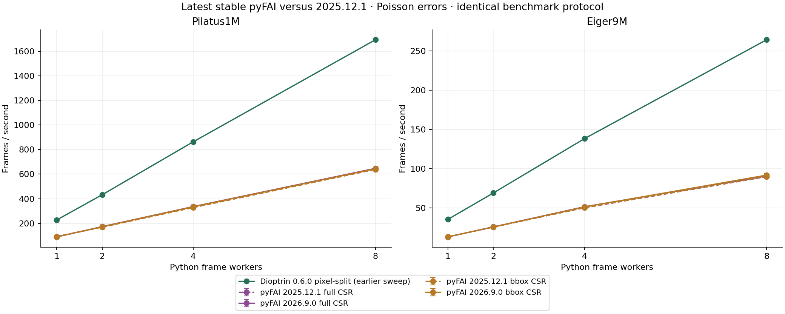

# Latest stable pyFAI control — 2026.9.0 versus 2025.12.1

At eight Python workers with Poisson errors, the new/old throughput factors were 1.008–1.019 (about 1–2% faster). Setup and memory were similar. Other worker counts showed small changes in both directions. Two trials per point do not establish a general performance gain; this test shows no large speed jump between these versions on this Mac/CPU backend.

| Detector | Method | Workers | 2025.12.1 fps | 2026.9.0 fps | Speed factor | Setup old → new (s) | Peak RSS old → new (GiB) |
| --- | --- | --- | --- | --- | --- | --- | --- |
| Pilatus1M | full CSR | 1 | 92.5 | 88.6 | 0.958× | 0.597 → 0.585 | 0.663 → 0.663 |
| Pilatus1M | full CSR | 8 | 639.2 | 647.2 | 1.013× | 1.332 → 1.309 | 1.443 → 1.440 |
| Pilatus1M | bbox CSR | 1 | 90.6 | 89.7 | 0.990× | 0.553 → 0.528 | 0.618 → 0.617 |
| Pilatus1M | bbox CSR | 8 | 638.7 | 644.1 | 1.008× | 0.893 → 0.905 | 0.990 → 0.990 |
| Eiger9M | full CSR | 1 | 12.9 | 12.9 | 0.999× | 1.745 → 1.713 | 3.930 → 3.929 |
| Eiger9M | full CSR | 8 | 89.8 | 90.6 | 1.009× | 7.000 → 7.163 | 10.063 → 10.054 |
| Eiger9M | bbox CSR | 1 | 13.0 | 13.1 | 1.013× | 1.408 → 1.431 | 3.484 → 3.483 |
| Eiger9M | bbox CSR | 8 | 90.0 | 91.7 | 1.019× | 3.523 → 3.638 | 5.159 → 5.158 |

All corresponding axes, intensities and available Poisson sigmas were byte-identical across both versions on all tested patterns. Maximum intensity relative L2 difference: 0; maximum Poisson sigma relative L2 difference: 0.

Apple M4 Pro, CPython 3.13.5. Both official macOS arm64 wheels rerun in an interleaved sweep with the same dependencies, images, masks, PONI geometry, 2,000 uniform 2theta bins, polarization 0.965 and solid-angle correction. Pilatus1M: 32 stored copies of one image; Eiger9M: 16 distinct real images. Each timed batch has 56 float64 frame references already in memory. Full CSR and bbox CSR are separate methods. One separate integrator and initialized CSR engine per persistent Python frame worker, with shared geometry arrays; 1/2/4/8 workers, OMP_NUM_THREADS=1, no GPU. Two fresh-process trials per point; three warm timing blocks targeting 0.5 s; intensity and Poisson modes. Imports, pool configuration and input warm-up are outside setup. Lazy imports reached inside pyFAI.load remain included in the constructor time. Constructor and post-constructor components are also recorded in the CSV. Setup measures construction, geometry/CSR initialization and a first Poisson result on every worker, initialized sequentially. Time to first result is also recorded. External RSS sampled every 10 ms, with live heap, USS and physical footprint separately. RSS includes input pages and allocator retention. Both error modes must pass the same <=3.6 other busy logical cores screen. No allocator overrides. All worker-count outputs checked against each version’s own one-worker reference. Version differences compare all 56 output patterns, including all 16 real Eiger images. Dioptrin/azint results displayed from the previously completed qualified sweep, not rerun here. Plot whiskers show the two-trial range, not statistical confidence intervals. This is a CPU/Python comparison and does not assess pyFAI GPU or other integration backends.

[All measurements CSV](dioptrin-pyfai-2026.9.0-speed-memory.csv) · [Numerical checks](dioptrin-pyfai-2026.9.0-numerical.json)

## Eight-worker comparison including Dioptrin and azint

| Detector | Library / method | Poisson fps | Workers ready (s) | First result (s) | Peak RSS (GiB) | Live heap (MiB) |
| --- | --- | --- | --- | --- | --- | --- |
| Pilatus1M | Dioptrin 0.6.0 supersampled | 1746.2 | 0.370 | 0.370 | 0.549 | 105.5 |
| Pilatus1M | Dioptrin 0.6.0 pixel-split | 1693.8 | 0.099 | 0.099 | 0.796 | 108.2 |
| Pilatus1M | azint generic | 574.0 | 0.768 | 0.768 | 0.592 | 75.2 |
| Pilatus1M | azint CPU/LTO/fast-math | 891.6 | 0.757 | 0.757 | 0.592 | 75.2 |
| Pilatus1M | pyFAI 2026.9.0 full CSR | 647.2 | 1.309 | 0.572 | 1.440 | 1002.2 |
| Pilatus1M | pyFAI 2026.9.0 bbox CSR | 644.1 | 0.905 | 0.530 | 0.990 | 525.1 |
| Eiger9M | Dioptrin 0.6.0 supersampled | 284.2 | 0.679 | 0.679 | 2.528 | 697.3 |
| Eiger9M | Dioptrin 0.6.0 pixel-split | 264.3 | 0.561 | 0.561 | 3.598 | 722.4 |
| Eiger9M | azint generic | 102.6 | 1.860 | 1.860 | 3.255 | 431.3 |
| Eiger9M | azint CPU/LTO/fast-math | 146.3 | 1.924 | 1.924 | 3.253 | 431.3 |
| Eiger9M | pyFAI 2026.9.0 full CSR | 90.6 | 7.163 | 1.730 | 10.054 | 8138.7 |
| Eiger9M | pyFAI 2026.9.0 bbox CSR | 91.7 | 3.638 | 1.475 | 5.158 | 3265.7 |
