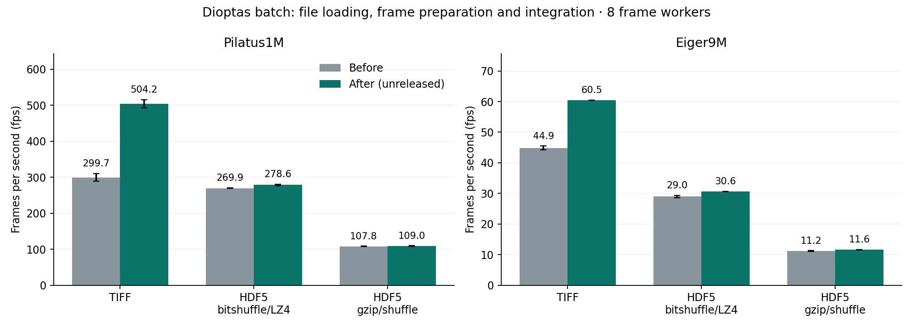
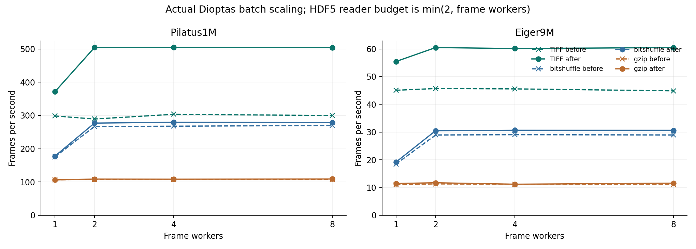
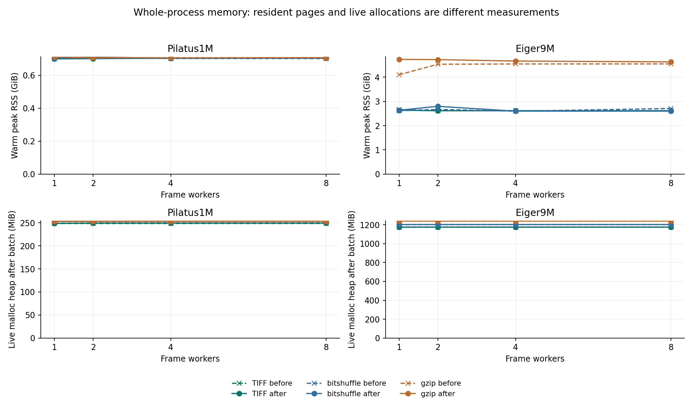
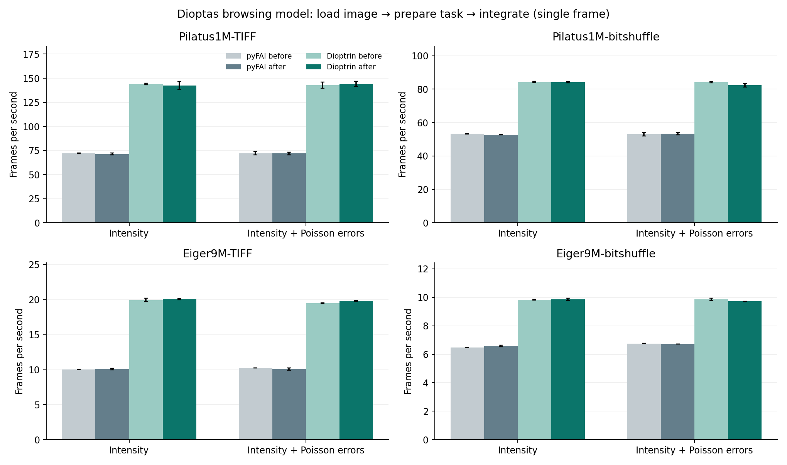

> **Note added 2026-11-15, not part of the original record.** The "after"
> numbers come from an unreleased Dioptrin build (the 0.6.1 source, c6cb083,
> plus `unadopted-copy-arrays.patch`) whose experimental
> `batch1d_iter(..., copy_arrays=False)` lent read-only NumPy frames to the
> stream instead of copying them. That option was not adopted: released
> Dioptrin streams always copy each frame. The Dioptas side of "after"
> (contiguous scaled snapshots, shapes read without scaling, an HDF5
> signature check) was on the unmerged Dioptas branch
> `codex/dioptas-pipeline-speed`.
>
> Only the eight-worker batch rows can be split, with the CSV's `app_only`
> control (new Dioptas, old native build, so frames are copied):
> Pilatus1M-TIFF 299.7 → 466.0 fps from the Dioptas side (1.55×), then
> → 504.2 from the native change (1.08×); Eiger9M-TIFF 44.9 → 55.2 (1.23×)
> → 60.5 (1.10×). For the four HDF5 rows the Dioptas side gives 0.97–1.01×
> and the native step 1.04–1.05×, so their gain is in the native step. That
> step is not borrowing alone: the patch also released the GIL while the
> producer waited for queue space, which Dioptrin 0.13.0 also does (in
> rewritten stream code), so how much of it came from borrowing cannot be
> determined here. The 1, 2 and 4 worker results have no such control and
> cannot be split. The browsing path does not use streams, so its small
> changes (0.98–1.02×) are Dioptas-side or noise. Nothing here was measured
> on current Dioptrin, so these numbers do not predict it in either
> direction.
>
> [`unadopted-copy-arrays.patch`](2026-10-25-dioptas-pipeline/unadopted-copy-arrays.patch)
> keeps the unadopted change: the six changed tracked files and the two new files
> (`docs/PYTHON_STREAMING_ARRAYS.md`,
> `python_examples/test_stream_array_borrowing.py`) of the benchmarked
> worktree. It applies to c6cb083 (`feat: release Dioptrin 0.6.1`), not to
> current main. The "HTML report" mentioned below was not kept; the CSV
> has the metrics it lists.

# Dioptas application pipeline benchmark — 25 October 2026

Completed local benchmark · unreleased changes

The real Dioptas reader and model paths include file loading, decoding and integration. fps means frames per second. These rates exclude Qt scheduling, screen drawing, acquisition and output writing. After is an unreleased local candidate; it is not the published Dioptrin 0.6.1 wheel.

## Eight frame workers

| Dataset | fps before → after | Factor | Warm peak RSS GiB | Live heap MiB |
| --- | --- | --- | --- | --- |
| Pilatus1M-TIFF | 299.7 → 504.2 | 1.68× | 0.701 → 0.704 | 248.6 → 249.6 |
| Pilatus1M-bitshuffle | 269.9 → 278.6 | 1.03× | 0.703 → 0.704 | 252.9 → 254.4 |
| Pilatus1M-gzip | 107.8 → 109.0 | 1.01× | 0.707 → 0.707 | 252.9 → 253.3 |
| Eiger9M-TIFF | 44.9 → 60.5 | 1.35× | 2.612 → 2.613 | 1175.5 → 1175.7 |
| Eiger9M-bitshuffle | 29.0 → 30.6 | 1.06× | 2.706 → 2.596 | 1202.1 → 1202.5 |
| Eiger9M-gzip | 11.2 → 11.6 | 1.03× | 4.544 → 4.628 | 1239.9 → 1240.3 |

## Implementation

Prepare scaling directly into contiguous storage; use existing dimensions without scaling an entire image; avoid failed HDF5 opens for other formats; opt in to retaining completed read-only frames in the native stream. Readers and scientific kernels remain unchanged. Published 0.6.1 remains supported through automatic fallback to copying.

At eight frame workers, TIFF throughput improves by 68% for Pilatus1M and 35% for Eiger9M in this workload. The HDF5 changes are smaller: bitshuffle gains are modest, while gzip remains dominated by decoding. The worker curves flatten when frame reading/preparation becomes the limiting stage. Removing transient copies reduces memory traffic; it does not remove the application’s retained image, geometry or HDF5-cache allocations.

## Validation and protocol

23,552 checked frame results from 184 accepted processes match their own frozen baseline byte-for-byte. 339 Dioptas tests pass, 2 skip; 162 Rust unit tests and 16 doc tests pass. New native streaming checks cover 5,120 frame/mode/worker combinations plus ownership and producer failures. Existing array/generator checks pass.

A separate mixed-format check reads TIFF, bitshuffle HDF5 with a 512-byte user block and unusual extension, TIFF, then gzip HDF5. All ten frames match exactly for intensity and azimuthal spread (20 candidate results). HDF5 signature detection and independent decoded-frame ownership also pass.

32 frame tasks per batch. Pilatus1M: 1043×981 pixels, repeated copies of one real image.
Eiger9M: 3262×3108 pixels, 16 distinct real images read twice. TIFF fixtures use int32 uncompressed images.
Each HDF5 container holds 16 int32 frames in one-frame chunks and is visited twice; containers are
constructed from the same real TIFF values using bitshuffle/LZ4 or gzip level 1 with shuffle.
This measures these exact HDF5 layouts, not every facility's HDF5 master/external-link layout.
The original local sources are Dioptrin/test_data/CeO2_Pilatus1M.tif and
Dioptrin/test_data/eiger_0000.h5 (/entry_0000/instrument/eiger/data, first 16 frames).
Large detector-image binaries are excluded from the evidence archive; input identities and the
derived TIFF/HDF5 preparation are retained in the manifest and preparation scripts.
2,000 uniform 2θ bins, existing pixel-split method, solid-angle correction, polarization 0.965,
the same mirrored PONI geometry and mask. The actual BatchModel batch path returns intensity only;
Poisson error calculation is tested in the separate browsing model path, with errors off and on.
The browsing path invokes ImgModel.load / load_series_img, Configuration.create_integration_task and
PersistentIntegrationEngine.compute for every frame. pyFAI uses Dioptas's existing method='csr' with
OMP_NUM_THREADS=1; this is the current application setting, not a separately selected full-split engine.

Apple M4 Pro (10 performance and 4 efficiency cores), 48 GiB RAM; macOS ARM64; CPython 3.13.5,
NumPy 2.4.1, pyFAI 2026.9.0, Fabio 2025.10.0, Pillow 12.3.0, PyQt6 / Qt 6.10.0.
Both versions use isolated h5py 3.15.1 (HDF5 1.14.6) and hdf5plugin 5.1.0 with explicit bundled-filter registration.
The installed environment's HDF5 2.0 runtime and system filters were incompatible during fixture creation;
the controlled runtime is shared by every comparison and does not modify the installed application.
Native baseline and candidate use Rust 1.93.0, the same Cargo.lock, generic CPU target, opt-level 3,
LTO and one codegen unit, licensed release builds, existing fast arithmetic enabled by default.
No compiler fast-math flags or integration kernels change here.
1/2/4/8 frame workers, one native compute thread per frame worker. The pre-existing bitshuffle reader
pool is explicitly limited to min(2, frame workers) in both versions; it is additional to integration workers.
Other numerical thread pools are limited to one. No unrelated jobs were suspended.
Two fresh processes per point, interleaved before/after, three warm timing blocks per process (target 0.5 s,
or one 32-frame batch when longer). Each reported rate is the median of the two process medians;
CSV retains both-process ranges. A process qualifies only when the median of its three timing blocks
has at most 3.6 other busy cores. Rejected runs are retained separately. These are descriptive ranges,
not confidence intervals; small gains within those ranges should not be interpreted as established.
Normal filesystem caches are warm. Files are reopened/read and decoded during timed processing;
this does not measure cold SSD, network transfer, acquisition, Qt scheduling, screen rendering or output-file writing.

See the HTML report and CSV for browsing with errors, the single-thread pyFAI comparison, all worker counts, configuration time, first-batch latency, lifetime/warm RSS, live heap, trial ranges and published-wheel/application-only controls.

## Figures and evidence

[All metrics and two-process ranges](2026-10-25-dioptas-pipeline/dioptas-pipeline-summary.csv) · [Structured summary](2026-10-25-dioptas-pipeline/summary.json) · [Source identities](2026-10-25-dioptas-pipeline/source-manifest.json)
