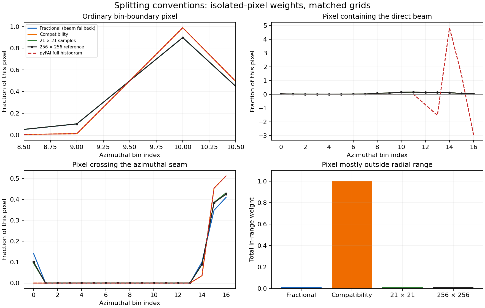

# Full-splitting investigation and azint-style sampling

2026-11-08; branch `codex/multi-detector-2d`, worktree
`/Users/clemens/Programming/Dioptrin-multi2d`. This follows the initial native
multi-detector implementation at `7e6b73b`. No release or desktop checkout edits.

## Conclusions and delivered changes

Two independent questions need different answers:

1. **Reproducing Qt/pyFAI full-histogram cakes:** the opt-in
   `pixel_split_mode="pyfai_histogram"` closely reproduces that splitting rule.
   With matched corrections/grids, the original beam/seam comparison improves
   from 2.2309% to **0.0000570% intensity**, and from 8.0131% to
   **0.000134% std**. The extra populated bin disappears. No normalization
   adjustment was used to obtain this improvement.
2. **Geometric coverage of a uniformly illuminated detector pixel:** the
   default `fractional` convention remains more defensible than clipped-pixel
   renormalization. Dense detector-plane sampling is a better reference than
   agreement with pyFAI alone. The existing `supersampled` method supplies the
   azint-style alternative throughout the detector.

A defect in the new shared-grid polygon path was also fixed: the single polar
quad of a pixel containing the direct beam is not a reliable description of
its coverage. Such pixels, detected by angular winding, an antipodal edge or a zero-radius corner,
now use detector-plane sampling in both polygon modes. The fallback uses
128 × 128 strata, with four symmetric samples per stratum (65,536 total).
The symmetric pattern avoids assigning a line of lattice samples arbitrarily
at exact azimuthal-bin boundaries. Contributions from one pixel to one bin are
combined before squaring the weight for variance.

Counting, explicit supersampling, ordinary single-detector integration and all
1D integration retain their previous algorithms. The optional mode applies only
to the new shared-grid 2D polygon path. Mode is part of the table-cache key.

## Exact usage

```python
# Closer reproduction of Qt/pyFAI full histogram; absolute solid-angle scale:
multi = dioptrin.MultiIntegrator(integrators, pixel_split_mode="pyfai_histogram")
result = multi.integrate2d(images, 2000, 360, errors=True, normalization="absolute")

# Geometric subpixel splitting, as used by azint: configure EACH detector.
integrators = [
    dioptrin.Integrator(path, method="supersampled", n_ss=21,
                       unit="q_A^-1", radial_range=(0.0, 8.0))
    for path in ["detector1.poni", "detector2.poni"]
]
multi = dioptrin.MultiIntegrator(integrators)
result = multi.integrate2d(images, 2000, 360, errors=True, normalization="absolute")
```

Rust selects the compatibility convention with
`multi.with_pixel_split_mode(PixelSplitMode::PyfaiHistogram)`.
`PixelSplitMode` is exported from `dioptrin::integration`. Raw single-detector
integration selects it with `grid.with_pixel_split_mode(...)`. Constructors
still default to `PixelSplitMode::Fractional`. Existing constructor calls and
`Multi2dOptions` fields are unchanged.

For azint-style splitting, Rust uses
`IntegrationMethod::Supersampled { n_ss: 21 }` on each Integrator. This means
441 sample centers per pixel, not 21 total samples. Increase to 41 and check
convergence on the intended output grid; there is no universal accuracy
threshold associated with either parameter.

## What caused the differences

The investigation exported individual pixel-to-bin weights through the public
raw Rust API, removing intensity, polarization and solid-angle corrections from
the comparison. The reference was pyFAI **2025.12.1**
`fullSplit2D_engine`, with matched effective bin edges and float32 corner
coordinates from its geometry implementation.

- **Ordinary bin edges:** a representative off-axis pixel contributes about
  0.10107 to one azimuthal bin under polygon clipping, but about 0.01063 under
  pyFAI's line-area rasterization. Dense sampling agrees closely with polygon
  clipping. These differences exist away from both the beam and the seam.
- **Seam:** the default convention keeps periodic polygon copies on both sides
  of the discontinuity. The reference recenters one quad, clips corner
  coordinates at the interval limits and renormalizes. It can move coverage
  from one side of the seam to the other instead of preserving both fractions.
- **Range clipping:** for an almost excluded example pixel, polygon clipping
  and dense sampling retain approximately 0.0124 total weight; the reference
  renormalizes the included remnant to 1. This changes that pixel's importance
  relative to other pixels even when the final cake intensity remains similar.
- **Direct beam:** the reference's isolated center-pixel weights include a
  minimum of **−2.95985** and a maximum near **4.83975**. These are not valid
  fractions of a pixel. The new sampling fallback produces finite nonnegative
  weights with total 1 for full coverage. The compatibility mode deliberately
  retains that fallback and discards negative numerical raster areas before
  renormalization; it does not reproduce every pathological reference value.

The original 2.23%/8.01% cake comparison masks both beam-containing pixels.
It therefore must **not** be described as an error measured directly at the
singular beam pixel. The isolated-pixel investigation above tests those pixels
unmasked and establishes a separate failure mode.

The compatibility implementation follows the reference's approximate line-area
rasterization and clipped-vertex convention, with float32 raster accumulation.
Geometry and the rest of Dioptrin's pipeline remain float64. This is approximate
compatibility, not bitwise equivalence or a new geometric-accuracy claim.
The adapted algorithm carries its upstream MIT notice in `src/lut/pyfai_split.rs`.

Primary sources:
[pyFAI fullSplit2D_engine](https://github.com/silx-kit/pyFAI/blob/v2025.12.1/src/pyFAI/ext/splitPixel.pyx),
[recenter/line-area kernels](https://github.com/silx-kit/pyFAI/blob/v2025.12.1/src/pyFAI/ext/regrid_common.pxi).

## Accuracy against dense detector sampling

For the six detector/scenario combinations, compare every unmasked isolated
pixel with a 256 × 256 midpoint-sampling reference. The metric below is
`mean_over_pixels(sum_over_bins(abs(weight - dense_weight)))`, an absolute
weight discrepancy, **not** relative cake-intensity error:

| Scenario | Detector | Fractional polygons + beam fallback | 21 × 21 samples | 41 × 41 samples | Compatibility raster |
| --- | ---: | ---: | ---: | ---: | ---: |
| Off axis | 0 | 0.000150 | 0.000349 | 0.000118 | 0.004519 |
| Off axis | 1 | 0.000263 | 0.000470 | 0.000141 | 0.006817 |
| Beam/seam | 0 | 0.003346 | 0.001396 | 0.000456 | 0.017425 |
| Beam/seam | 1 | 0.002785 | 0.001449 | 0.000449 | 0.012404 |
| Radial crop | 0 | 0.000279 | 0.000691 | 0.000219 | 0.014149 |
| Radial crop | 1 | 0.000469 | 0.001022 | 0.000318 | 0.018482 |

In these synthetic cases, the default polygons outperform the compatibility
raster against detector-plane sampling. Twenty-one samples per axis are better
than polygons in the beam/seam scenes; 41 improves over 21 throughout. Away
from the beam, exact polygon intersections can outperform a coarse sampling
grid. These observations support retaining both options, not declaring one
method universally exact. A uniform subpixel detector response is assumed;
actual intrapixel response, distortion and curved detector pixels are not
modeled here. The 256 × 256 reference is finite-resolution too.



The top-right panel deliberately shows the reference's negative and greater-than-one
weights. The nonnegative curves overlap near zero on that scale. The bottom-left
panel demonstrates loss of a seam-side contribution under compatibility rules.

[Raw weight metrics](multi2d-splitting-weights.json).
Reproduce with:

```sh
python python_examples/inspect_full_split.py \
  --report docs/validation/multi2d-splitting-weights.json \
  --figure docs/validation/multi2d-splitting.png
```

The script builds `examples/inspect_split_weights.rs`, which exports impulse
responses through `Integrator::integrate2d_raw_on_grid_from_slice`. No installed
Python package is modified. The example can also export other units or grids.

## Relationship to azint

The inspected [azint C++ source](https://github.com/maxiv-science/azint/blob/4f78cc3b1d8cab67128c9679f55de6340c68f191/azint.cpp)
uses midpoint positions `(k+0.5)/n_splitting`, transforms them through the
detector geometry, bins each sample and sums duplicate pixel/bin contributions
with weight `1/n_splitting²`. This matches the geometric approach of Dioptrin's
existing `Supersampled` method for flat rectangular pixels.

Full numerical equivalence is not claimed. Azint uses float32 geometry and
weights and lower_bound edge lookup, whereas Dioptrin uses float64 and half-open
bins. More significantly, azint averages individually corrected pixel signals;
Dioptrin's multi path retains raw signal divided by accumulated correction
normalization. That estimator and its absolute detector factors should not be
changed just to copy the sampling approach. Azint's additional detector models
and arbitrary edge sequences are not added here. Source inspection plus a
vector-geometry numerical oracle was used; the azint binary was not installed
or executed in this validation.

## Validation and cost

**195 Rust tests, 16 doctests and six Python tests passed**, including 18 main
pyFAI comparisons plus three sector/discontinuity comparisons. Strict Clippy
and rustfmt checks passed. Both an ARM64 CPython 3.13 wheel and the native
benchmark examples built successfully.


The numerical tests add beam-pixel eightfold symmetry, positivity, total coverage,
sector clipping, analytic small-disk coverage at a beam on a pixel edge/corner,
tilted geometry, cache separation/restoration, a pyFAI boundary
pixel golden weight, preservation of other methods/1D, and an independent
21 × 21 vector-geometry oracle with masks and all four radial units. Python
checks both conventions against pyFAI, including azimuthal sectors and the
0–360° discontinuity convention.

For the same small synthetic benchmark as the initial report, with eight Rayon
threads and errors enabled: compatibility polygons prepared in **16.3 ms**;
21 × 21 supersampling prepared in **128.9 ms**. Cached medians were **0.77 ms**
and **0.85 ms**, respectively. These include Python copies/result-object construction (excluding list getters),
exclude I/O, and are characterization results rather than universal throughput
claims. [Timing receipt](multi2d-splitting-timing.json).

The larger **2000 × 360** cake benchmarks, including a real Eiger frame and
separate native/Python first-frame and cached latencies, are in
[multi2d-startup.md](multi2d-startup.md).
